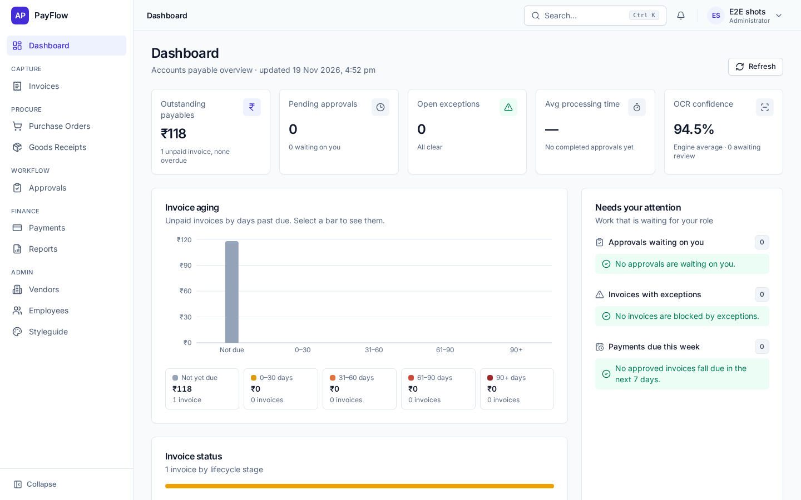
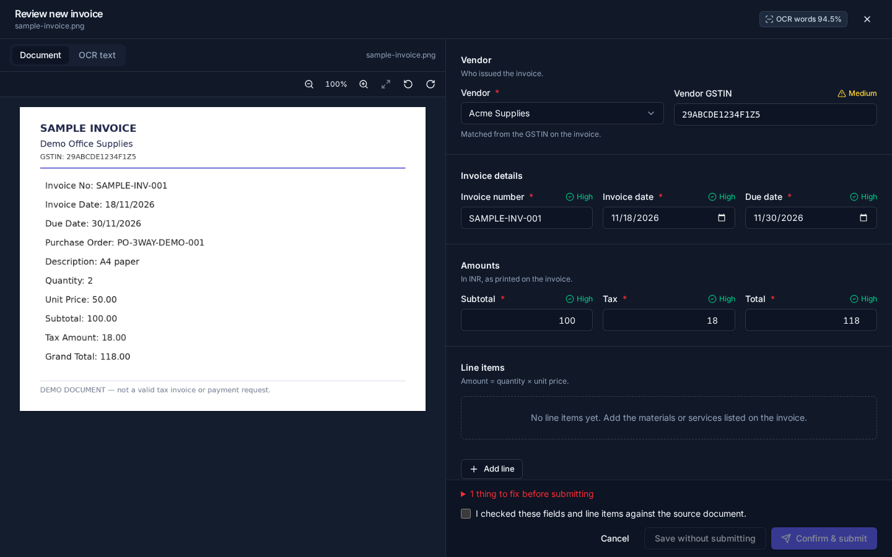
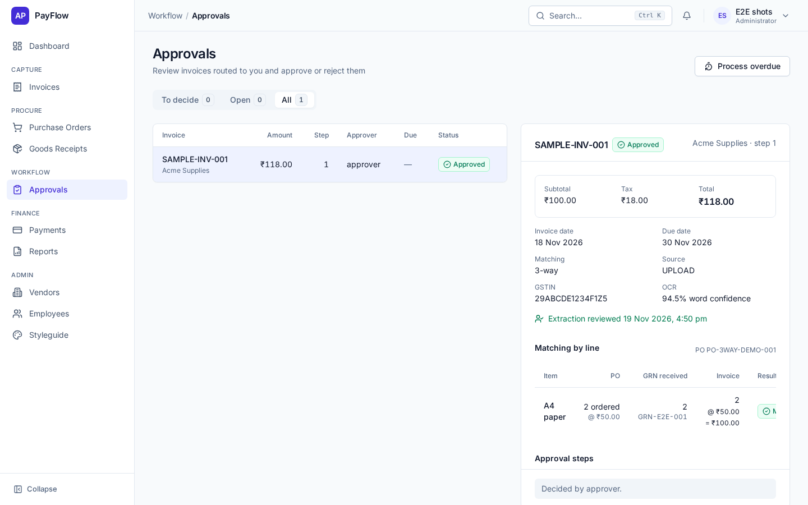
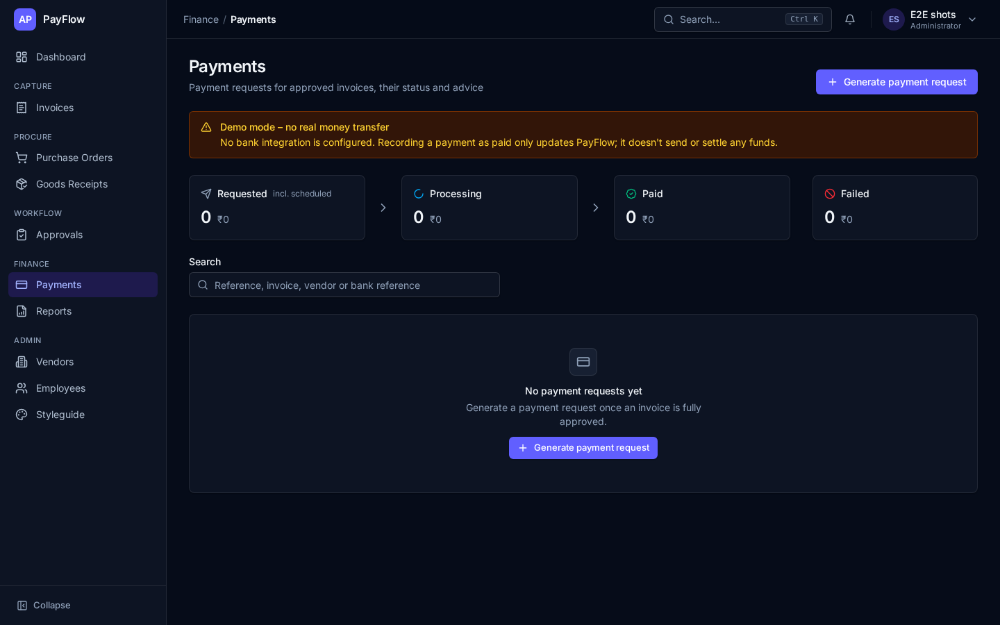
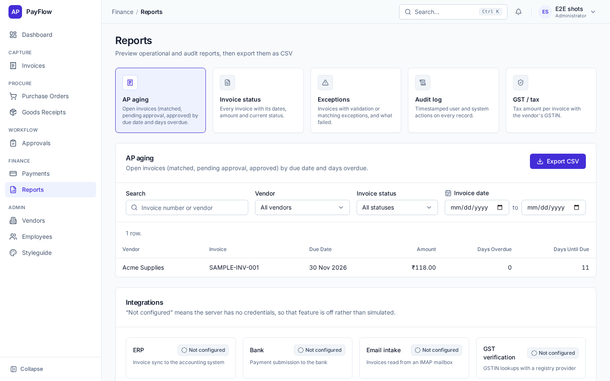
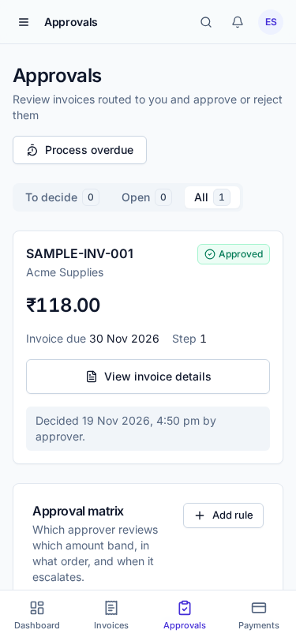
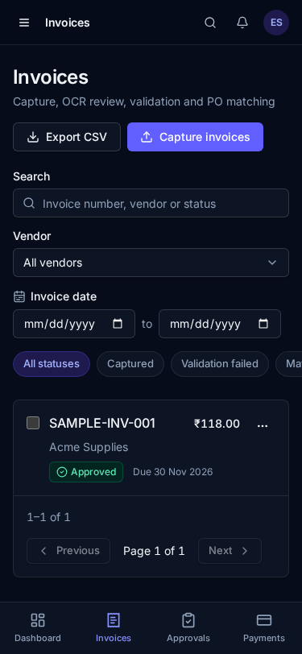
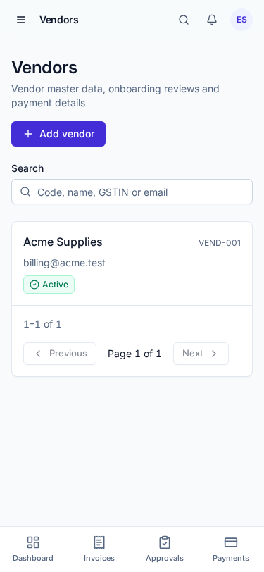
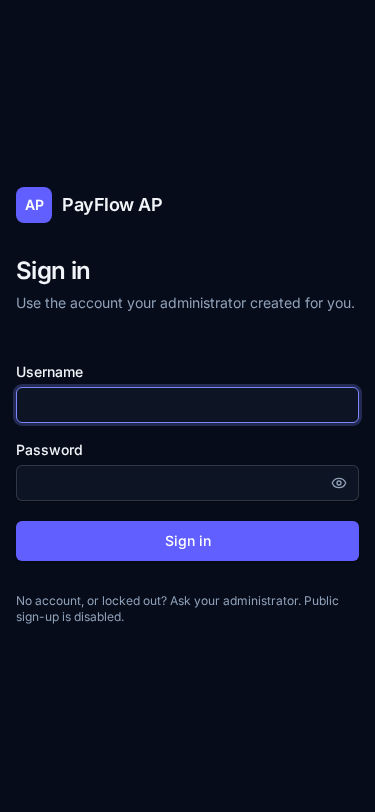

# Accounts Payable Automation System

A full-stack AP automation application built with React/Vite, Django REST Framework, and PostgreSQL.



## Screenshots

Every page in light and dark at 1440px and 375px is in [`docs/screenshots/`](docs/screenshots/). Regenerate them with `npm run screenshots` (see [End-to-end tests](#end-to-end-tests-playwright)).

| OCR review (dark) | Approvals queue + preview |
|---|---|
|  |  |
| **Payments pipeline (dark)** | **Reports** |
|  |  |

| Mobile approvals | Mobile invoices (dark) | Mobile vendors | Sign in (dark) |
|---|---|---|---|
|  |  |  |  |

## Features

- JWT authentication and role-based access control
- Invoice upload, bulk upload, and mailbox attachment ingestion over IMAP
- Multipage PDF and TIFF OCR with page-level text, confidence scoring, and reviewable field suggestions
- Mandatory field, duplicate, GST, amount and active-vendor validation
- Purchase-order material lines, goods receipts, and 2-way/3-way matching with received-quantity and unit-price checks
- Configurable approval matrices, sequential and parallel approval support, role routing, deadlines, and administrator-triggered overdue escalation
- In-app approval reminders for items due within 24 hours
- Vendor onboarding and bank/GST master management
- Optional live GST verification, ERP posting, bank submission, IMAP intake, and SMTP notifications when provider credentials are configured
- Payment requests, statuses, bank-reference tracking, and viewable payment advice
- Dashboard aging, approval queue, approval turnaround, reviewed-field extraction accuracy, vendor analytics, payment tracking and exceptions
- CSV reports for AP aging, invoice status, exceptions, GST/tax, and audit activity
- Immutable audit log records
- Swagger/OpenAPI documentation
- Responsive UI with light/dark themes (follows the OS by default), a ⌘/Ctrl+K command palette, a split-view OCR review workspace, and a card-per-invoice mobile approval view with large Approve/Reject buttons
- Keyboard operable throughout, with visible focus rings and WCAG 2.1 AA color contrast in both themes (checked automatically with axe-core); animations respect *reduce motion*

## Administrator and employee accounts

Public registration is disabled. After applying migrations, create the first administrator interactively with `python manage.py create_ap_admin`; the password is entered without being displayed. Administrators create employee accounts from the Employees page. New employees start inactive and an administrator must activate them before login.

`python manage.py seed_demo` is an optional local-only command for synthetic demonstration records. It requires `DEBUG=true`, `AP_ALLOW_DEMO_SEED=true`, and `DEMO_ADMIN_PASSWORD`/`DEMO_APPROVER_PASSWORD` in the local environment. It never resets existing account passwords. Do not use the seed command for production data.

## Sample invoice for OCR testing

Use [sample-invoice.png](docs/assets/sample-invoice.png) when testing the invoice upload and OCR preview. It is explicitly marked as a demo document and is not a valid tax invoice.

## Prerequisites

- Python 3.8+ and PostgreSQL 12+
- Node.js 20+ (tested with Node 24) and npm
- Tesseract OCR and Poppler for invoice OCR (`sudo apt install tesseract-ocr poppler-utils` on Debian/Ubuntu, `brew install tesseract poppler` on macOS)

## Backend setup

```bash
cd backend
python3 -m pip install -r requirements.txt
cp .env.example .env
# Edit .env with the PostgreSQL database name, user, password, host, and port before continuing.
python3 manage.py migrate
python3 manage.py create_ap_admin
python3 manage.py runserver 0.0.0.0:8000
```

PostgreSQL must be running and configured via environment variables. API: `http://localhost:8000/api/`; Swagger: `http://localhost:8000/api/docs/`.
The default application timezone is India Standard Time (`Asia/Kolkata`); configure `DJANGO_TIME_ZONE` in `backend/.env` if your deployment uses another timezone. Database timestamps remain timezone-aware.

### Optional external integrations

Copy `backend/.env.example` to `backend/.env` and configure only the providers you actually use. The application does not include provider credentials or pretend an unconfigured connector succeeded. ERP and bank requests require their respective HTTPS URL and token; bank submission changes a payment to `PROCESSING` only after a successful provider response. “Record demo payment” in the UI is a local demonstration action, not a transfer of funds.

IMAP invoice intake requires `IMAP_HOST`, `IMAP_USER`, and `IMAP_PASSWORD`. Run one mailbox pass with:

```bash
cd backend
python3 manage.py ingest_email_invoices --once
```

Or run a polling worker (minimum interval is five seconds):

```bash
python3 manage.py ingest_email_invoices --poll-seconds 60
```

Configure SMTP (`SMTP_HOST`, `SMTP_USER`, `SMTP_PASSWORD`) to deliver stored in-app notifications by email:

```bash
python3 manage.py send_ap_notifications
```

Approval reminder/escalation processing is also explicit and can be run once or scheduled with the host's task scheduler:

```bash
python3 manage.py process_approvals
```

For example, run `process_approvals` hourly from cron in the backend environment. Due-soon notifications are deduplicated for 24 hours; overdue pending approvals are escalated when this command runs.

## Frontend setup

```bash
cd frontend
npm install
cp .env.example .env
npm run dev
```

Frontend: `http://localhost:5173`.

Production frontend build:

```bash
npm run build
npm run preview
```

## Tests

Backend unit tests (need a reachable PostgreSQL to create the test database):

```bash
cd backend
python3 manage.py test ap_app -v 2
python3 manage.py check
python3 manage.py makemigrations --check --dry-run
```

Frontend production build check:

```bash
cd frontend
npm run build
```

### End-to-end tests (Playwright)

The e2e suite starts its **own** backend and frontend: `frontend/e2e/start-backend.sh` drops and recreates a throwaway PostgreSQL database named `ap_e2e` (the name must contain `e2e`), migrates it, seeds demo users with `seed_demo`, and serves the API on port 8020. Vite runs on port 5190. Your development database and the servers on 8000/5173 are not touched. Database credentials come from `backend/.env`; the PostgreSQL user needs permission to create databases.

```bash
cd frontend
npm install
npx playwright install chromium   # one-time browser download
npm run test:e2e                  # everything: smoke, accessibility, screenshots (~4 minutes)
npm run test:smoke                # login, dashboard, single upload → review → submit, bulk upload,
                                  # approve on a 375px phone, theme toggle
npm run test:a11y                 # axe-core WCAG 2.1 AA on every page in light and dark, dialogs,
                                  # 375px views, keyboard and reduced-motion checks
npm run screenshots               # regenerates docs/screenshots/ (runs the smoke flow first for data)
npx playwright show-report e2e/.report
```

Test-only passwords can be overridden with `E2E_ADMIN_PASSWORD` and `E2E_APPROVER_PASSWORD`, and the ports with `E2E_API_PORT` and `E2E_WEB_PORT`. Login is rate-limited to 10 per hour per IP, so the setup step signs each test user in once and reuses the session; the backend restarts (and the limit resets) on every run.

## Requirements checklist

### Role access

Administrators manage employees and all resources. Public registration is disabled; new accounts remain inactive until an administrator activates them. AP clerks maintain vendors, purchase orders, receipts and invoices. Approvers can view and decide only assigned approvals and their invoices. Accountants manage payment actions; auditors have read-only report/audit access. Vendor bank account and IFSC values are masked in general responses.

| PDF requirement | Implementation |
|---|---|
| PDF, image, email, drag/drop, bulk, PDF/JPG/PNG/TIFF | Upload and bulk APIs, supported document formats, and optional IMAP attachment ingestion; React file controls; Django validation and storage |
| OCR extraction; line items; AI field identification; tables; multipage | Tesseract OCR supports multipage PDFs and TIFFs, stores text/confidence, and provides rule-based suggestions. Optionally, a configured local Ollama-compatible model can fill missing fields and suggest line items; its output is checked and remains a draft for human review. 3-way matching requires selecting the corresponding PO line. |
| Mandatory, duplicate, GST, amount, vendor validation | Backend and form validation, vendor-specific invoice number and exact file duplicate constraints, human review before approval; external GST authority checks require configuration |
| 2-way PO/Invoice and 3-way PO/GRN/Invoice | Item, quantity, unit price and amount checks with configurable environment tolerances; 3-way uses received quantities |
| Approval matrix, roles, escalation, reminders, parallel, mobile | Amount-based rules, sequential/parallel routing, role checks, reminders and scheduled overdue processing |
| Vendor master, bank, GST/TIN, onboarding | Vendor master, GST/bank fields, pending onboarding, and administrator approval/rejection |
| Payment request, status, banking, advice | Payment model/API/workflow and advice; optional configured bank connector (no transfer without provider setup) |
| Aging, pending approvals, turnaround, OCR accuracy, vendor analytics, payment | Database-backed cards and charts; field accuracy is measured from human field reviews, and unreviewed fields are excluded |
| Aging/status/exception/audit/GST reports | CSV report endpoints for invoice aging, status, exceptions, GST/tax, and audit logs |

### Scope assumptions and external dependencies

Rule-based OCR suggestions remain available without a model. Optional semantic extraction uses a local Ollama-compatible OpenAI chat endpoint and is disabled unless `LOCAL_LLM_MODEL` is set in `backend/.env`; `LOCAL_LLM_BASE_URL` must use HTTP loopback. Install/run Ollama and download a model separately, then set its installed model name. OCR text is sent only to that configured local endpoint, and a model outage falls back to the rule-based suggestions. All suggestions require human review. The dashboard extraction percentage is based on field-level human review records; Tesseract word confidence remains separately labeled in invoice review and is not presented as accuracy. Bulk and email attachment capture use the same OCR extraction and validation path and retain incomplete captures in a validation-failed state for review. ERP, bank, GST, IMAP, and SMTP connectivity is implemented as optional, credential-based integration; live provider behavior requires the organization's endpoint, credentials, and provider-specific contract. Scheduled reminders require the documented management command to be run periodically.

## PostgreSQL schema

See [docs/database-schema.md](docs/database-schema.md) for relationships, key fields, constraints and migration commands.

## Submission materials

- Complete local source: `frontend/` and `backend/`.
- PostgreSQL tables and relationships: [Database schema](docs/database-schema.md).
- Development/deployment challenges: [Challenges and solutions](docs/challenges-and-solutions.md).
- Demo recording outline: [Demo video guide](docs/demo-video-script.md). Record and submit the video separately; no video file is included in this repository.

This workspace has no configured GitHub remote or hosted deployment URL. Publish the source repository and provide its URL as a separate submission step. The application currently runs locally; it is not deployed as a live hosted service.

## API overview

See [docs/api.md](docs/api.md) and the live Swagger schema. The first admin is created with `create_ap_admin`; public self-registration is disabled. New employee accounts remain inactive until activated by an administrator.

See [DEPLOYMENT_GUIDE.md](DEPLOYMENT_GUIDE.md) for local configuration, deployment preparation and external integration setup.
