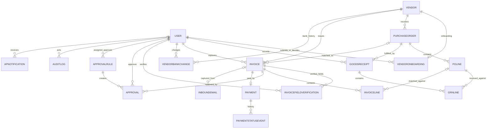

# PostgreSQL Database Schema

The application uses Django models and PostgreSQL migrations. IDs are generated primary keys unless noted. Django's custom `ap_app_user` extends `AbstractUser` (including username, password hash, email, names, active/staff flags, and authentication timestamps) with the `role` field below. `JSONField` maps to PostgreSQL `jsonb`; `DecimalField` maps to fixed-precision numeric values.

## Tables and fields

| Table | Fields (type; `?` means nullable/blank) |
|---|---|
| `ap_app_user` | Django `AbstractUser` columns; `role varchar(20)` (`ADMIN`, `AP_CLERK`, `APPROVER`, `ACCOUNTANT`, `AUDITOR`; default `AP_CLERK`) |
| `ap_app_vendor` | `code varchar(40)` unique, `name varchar(200)`, `email`, `phone varchar(30)?`, `gstin varchar(15)?`, `pan varchar(10)?`, `bank_name varchar(100)?`, `bank_account varchar(34)?`, `ifsc varchar(11)?`, `gst_verification_status`, `gst_verification_checked_at?`, `bank_verification_status`, `status varchar(20)`, `address text?`, `created_at`, `updated_at` |
| `ap_app_vendoronboarding` | `vendor_id` one-to-one FK, `status varchar(20)`, `submitted_by_id` FK, `decided_by_id` FK?, `comments text?`, `submitted_at`, `decided_at`? |
| `ap_app_purchaseorder` | `number varchar(50)` unique, `vendor_id` FK, `order_date date`, `expected_date date?`, `total_amount numeric(14,2)`, `status varchar(20)`, `created_at` |
| `ap_app_poline` | `purchase_order_id` FK, `description varchar(255)`, `quantity numeric(12,3)`, `unit_price numeric(12,2)`, `received_quantity numeric(12,3)` |
| `ap_app_goodsreceipt` | `purchase_order_id` FK, `number varchar(50)` unique, `received_date date`, `received_by_id` FK, `notes text?` |
| `ap_app_grnline` | `grn_id` FK, `po_line_id` FK, `quantity numeric(12,3)` |
| `ap_app_invoice` | `invoice_number varchar(80)?`, `content_hash varchar(64)?`, `vendor_id` FK, `purchase_order_id` FK?, `invoice_date date?`, `due_date date?`, `subtotal/tax_amount/total_amount numeric(14,2)`, `status varchar(30)`, `match_type varchar(10)`, `file`, `original_filename varchar(255)?`, `ocr_text text?`, `ocr_accuracy numeric(5,2)` (Tesseract word confidence), `ocr_suggestions jsonb`, `extracted_gstin varchar(15)?`, `extraction_reviewed_at/by?`, `approval_completed_at?`, `exceptions jsonb`, `capture_source varchar(20)`, `created_by_id` FK, `created_at`, `updated_at` |
| `ap_app_invoiceline` | `invoice_id` FK, `po_line_id` FK?, `description varchar(255)`, `quantity numeric(12,3)`, `unit_price numeric(12,2)`, `tax_rate numeric(5,2)`, `amount numeric(14,2)` |
| `ap_app_approvalrule` | `name varchar(100)`, `min_amount/max_amount numeric(14,2)`, `role_id` FK to an approver user, `sequence smallint`, `parallel boolean`, `escalation_hours integer` |
| `ap_app_approval` | `invoice_id` FK, `approver_id` FK, `rule_id` FK, `status varchar(20)`, `sequence smallint`, `comments text?`, `due_at/decided_at timestamp?`; unique `(invoice_id, approver_id, sequence)` |
| `ap_app_payment` | `invoice_id` one-to-one FK, `reference varchar(80)` unique, `amount numeric(14,2)`, `status varchar(20)`, `bank_reference varchar(100)?`, `payment_method varchar(30)`, `advice text?`, `requested_at`, `processed_at?` |
| `ap_app_vendorbankchange` | `vendor_id` FK, `changed_by_id` FK, previous/new masked account, bank name and IFSC values, `changed_at` (never stores full old/new account numbers) |
| `ap_app_invoicefieldverification` | `invoice_id` FK, `field_name`, suggested and verified values, `suggestion_correct`, `verified_by_id` FK, `verified_at`; unique `(invoice_id, field_name)` |
| `ap_app_paymentstatusevent` | `payment_id` FK, previous/new status, note, `changed_by_id` FK?, `changed_at` |
| `ap_app_auditlog` | `actor_id` FK?, `action varchar(100)`, `entity_type varchar(100)`, `entity_id integer`, `details jsonb`, `timestamp` |
| `ap_app_apnotification` | `recipient_id` FK, `title varchar(160)`, `message text`, `entity_type varchar(80)?`, `entity_id integer?`, `created_at`, `read_at?`, `email_sent_at?` |
| `ap_app_integrationdelivery` | `provider varchar(10)`, `entity_type varchar(40)`, `entity_id integer`, `idempotency_key varchar(120)` unique, `status varchar(20)`, `response_status smallint?`, `response_summary varchar(500)?`, `attempted_at`, `attempted_by_id` FK? |
| `ap_app_inboundemail` | `message_id varchar(255)` unique, `sender email?`, `subject varchar(255)?`, `status varchar(20)`, `details text?`, `invoice_id` FK?, `received_at`, `processed_at` |

The standard Django `auth`, `admin`, `contenttypes`, and `sessions` tables are also created by migrations.

## Relationships



## Constraints and indexes

- Unique vendor invoice number: `(vendor_id, invoice_number)` (PostgreSQL permits multiple null invoice numbers pending manual review)
- Unique exact-upload digest per vendor: `(vendor_id, content_hash)` when the digest is not null
- Unique approval: `(invoice_id, approver_id, sequence)`
- Unique vendor code and PO number
- Vendor and PO foreign keys use protected deletion
- Status/due-date and invoice-number indexes
- Django model validation for positive totals and invoice/due dates

Foreign keys use the deletion behavior declared on the models: for example, invoice/vendor and payment/invoice links are protected, while invoice lines cascade with their invoice. The exact installed schema is produced by the migrations in `backend/ap_app/migrations/`.

## Generate/update migrations

```bash
python manage.py makemigrations
python manage.py migrate
```
